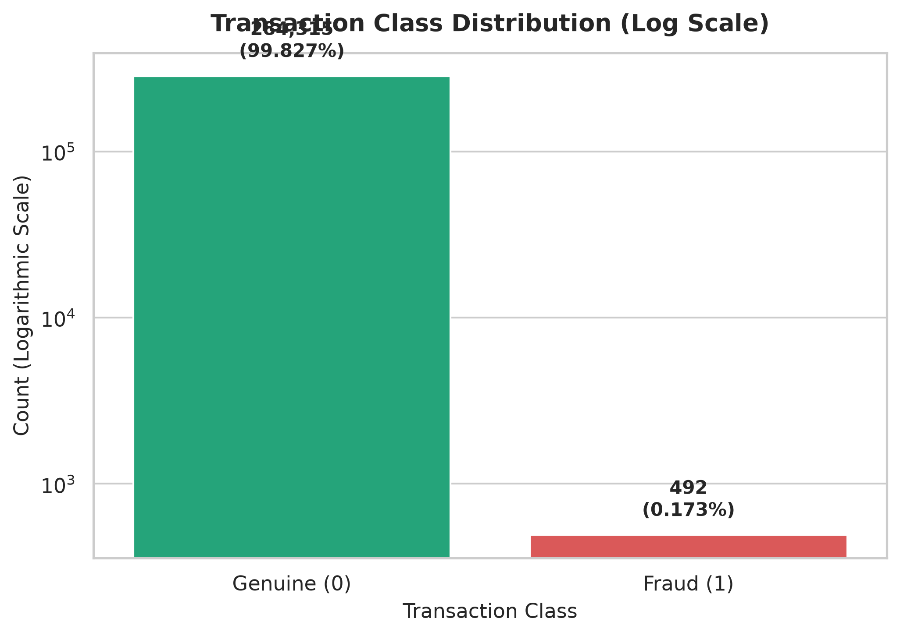
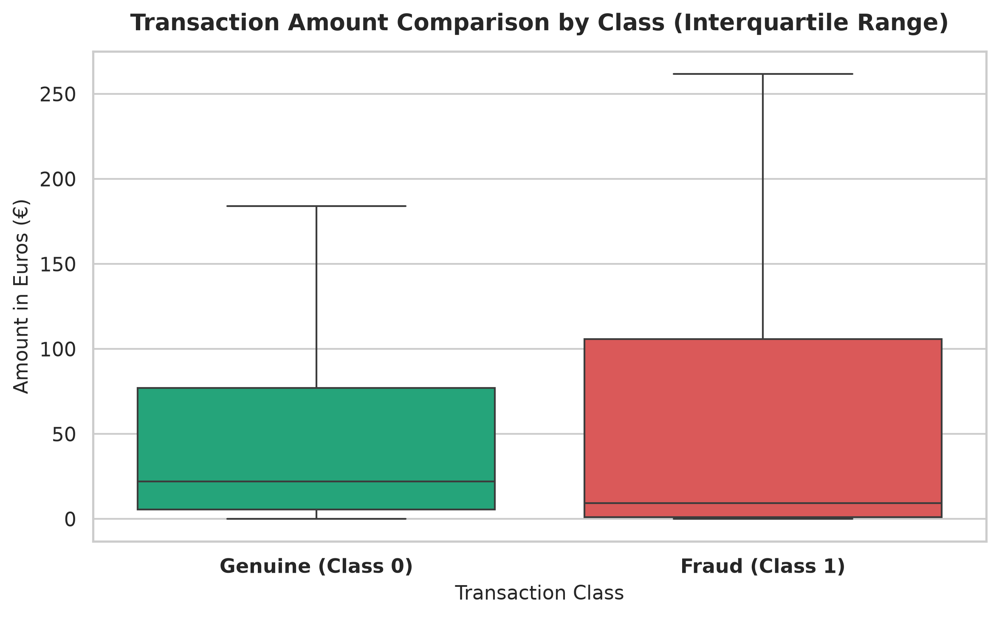
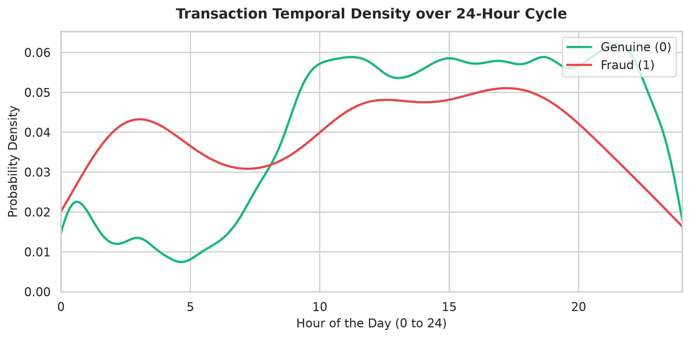
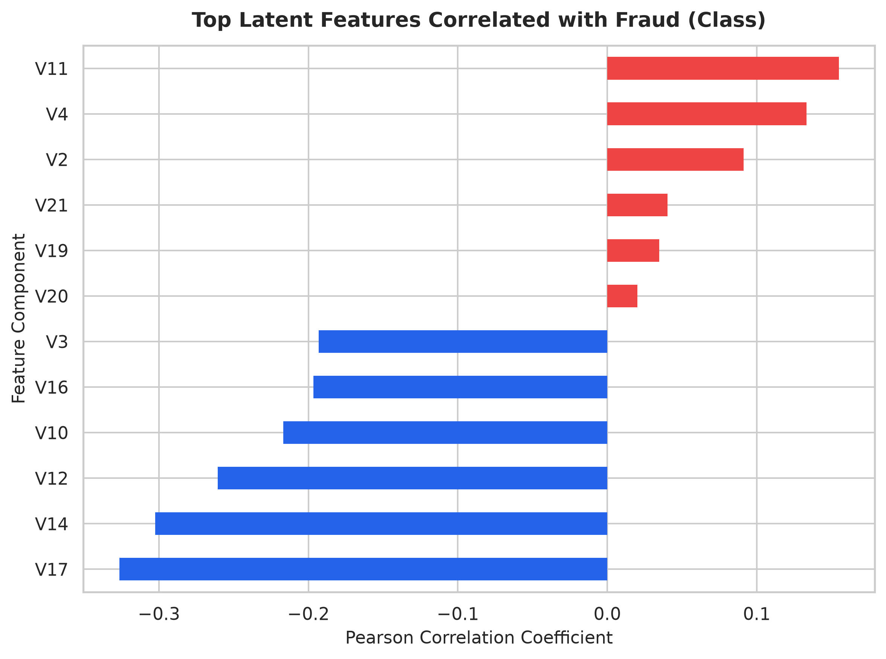
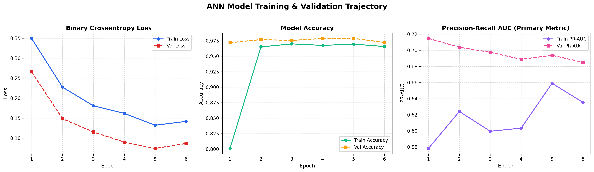
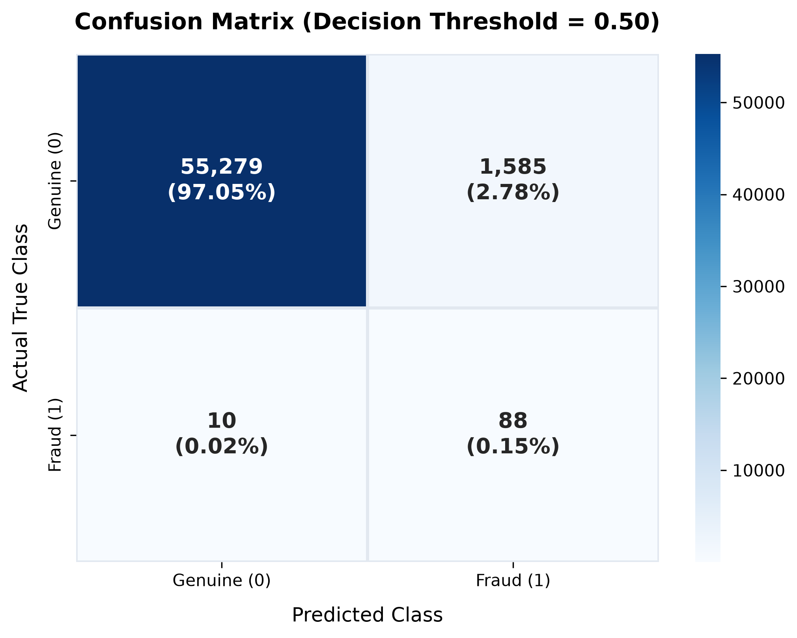
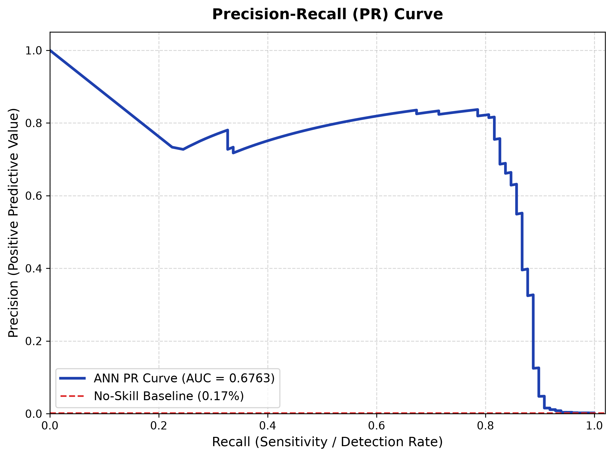
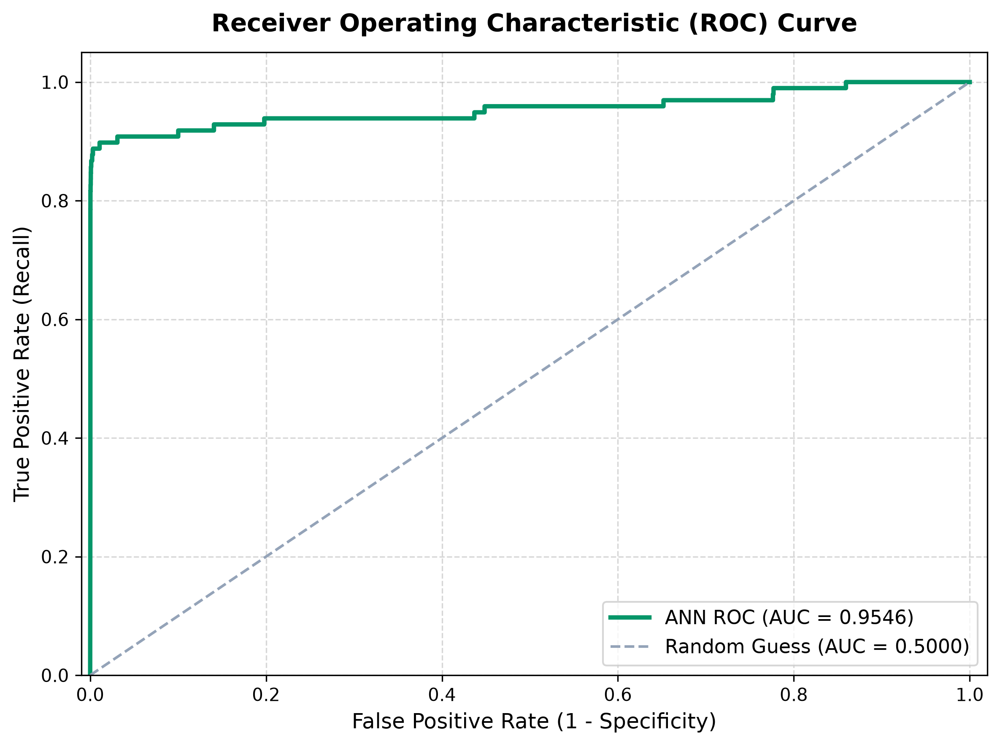

# Credit Card Fraud Detection Using Artificial Neural Networks (ANN)

[](https://www.python.org/)
[](https://tensorflow.org/)
[](https://keras.io/)
[](https://streamlit.io/)
[](https://opensource.org/licenses/MIT)

A production-grade, end-to-end Machine Learning and Deep Learning system designed to detect fraudulent credit card transactions in real-time. Built with **TensorFlow / Keras**, **Scikit-learn**, and **Streamlit**, this project addresses the challenges of extreme class imbalance (**0.17% fraud prevalence**) in high-throughput banking environments.

---

## 1. Project Overview & Problem Statement

Financial institutions worldwide suffer billions of dollars in annual fraud losses. Detecting card fraud presents three critical machine learning challenges:
1. **Extreme Class Imbalance:** Fraudulent transactions account for only **0.1727%** of all events (492 fraud cases out of 284,807 transactions).
2. **Asymmetric Misclassification Costs:** In financial surveillance, missing a fraud case (**False Negative**) results in direct financial theft and regulatory liability, whereas flagging a genuine cardholder (**False Positive**) causes minor customer friction.
3. **Data Leakage Vulnerability:** Standardizing continuous variables prior to train-test splitting leaks test distribution parameters into training, leading to overly optimistic results that fail in production.

---

## 2. Project Objectives

- Construct a fully modular, reproducible Artificial Neural Network (ANN) trained on real European credit card transactions.
- Eliminate data leakage by fitting preprocessing scalers strictly on training partitions.
- Address severe class imbalance using inverse-frequency class weights ($w_{\text{fraud}} \approx 289$).
- Evaluate performance using non-deceptive metrics (**PR-AUC**, **ROC-AUC**, **Recall**, and **Precision**) rather than raw accuracy.
- Provide interactive decision threshold calibration to allow risk teams to balance fraud capture vs. false alarms.
- Deploy an intuitive, banking-grade Streamlit web dashboard for real-time single-transaction scoring and high-volume batch CSV inference.

---

## 3. Dataset Description

The project uses the benchmark **Kaggle Credit Card Fraud Detection Dataset** (European cardholder transactions):
- **Source:** [Kaggle MLG - ULB Credit Card Fraud Dataset](https://www.kaggle.com/datasets/mlg-ulb/creditcardfraud)
- **Total Transactions:** 284,807
- **Genuine Transactions (Class 0):** 284,315 (99.827%)
- **Fraudulent Transactions (Class 1):** 492 (0.1727%)
- **Features (30 Numerical Inputs):**
  - `Time`: Elapsed seconds between each transaction and the first transaction in the dataset (spans 48 hours / 172,800 seconds).
  - `V1` to `V28`: 28 principal component analysis (PCA) numerical latent representations (transformed for cardholder privacy).
  - `Amount`: Transaction value in Euros (€).
- **Target Variable:** `Class` (0 = Genuine, 1 = Fraudulent).

---

## 4. Visual Exploratory Data Analysis (EDA)

### Transaction Class Imbalance
The dataset contains 284,315 legitimate transactions and only 492 fraudulent transactions (0.17%).



---

### Transaction Amount Comparison
Genuine transactions reach up to €25,691, whereas fraudulent transactions are concentrated in lower amounts (median €9.25), characteristic of card-probing behavior.



---

### 24-Hour Temporal Transaction Patterns
Legitimate transactions follow a natural diurnal cycle with a sharp drop between 1 AM and 6 AM. Fraudulent transactions maintain steady activity throughout nocturnal hours.



---

### Top Discriminative Latent Features
Correlation analysis identifies `V17`, `V14`, `V12`, and `V10` as strongly negatively correlated with fraudulent transactions, providing the primary discriminating signals for the neural network.



---

## 5. Artificial Neural Network Architecture

The model is built as a sequential deep feedforward neural network optimized for tabular anomaly detection:

```
Input Vector (30 Features: Time, V1-V28, Amount)
       │
       ▼
[Dense Layer 1: 64 Neurons, ReLU Activation]
       │
       ▼
[Dropout Regularization: Rate = 0.30]
       │
       ▼
[Dense Layer 2: 32 Neurons, ReLU Activation]
       │
       ▼
[Dropout Regularization: Rate = 0.20]
       │
       ▼
[Dense Layer 3: 16 Neurons, ReLU Activation]
       │
       ▼
[Output Layer: 1 Neuron, Sigmoid Activation]
       │
       ▼
P(Fraud | X) ∈ [0, 1]
```

### Architectural Specifications:
- **Total Parameters:** 4,609 trainable parameters.
- **Optimizer:** Adam ($\text{learning\_rate} = 0.001$).
- **Loss Function:** Binary Crossentropy.
- **Optimization Metric:** Precision-Recall AUC (`val_pr_auc`).
- **Regularization:** Dropout (0.3 and 0.2) + Early Stopping (`patience=5`).
- **Batch Size:** 2,048 (vectorized mini-batch execution).
- **Class Weights:** Inverse-frequency class weighting ($w_0 = 0.5009$, $w_1 = 289.33$).

---

## 6. Model Training & Validation Trajectory

During training, the model converged within 6 epochs before early stopping restored the optimal checkpoint, achieving balanced generalization without overfitting.



---

## 7. Model Evaluation on Held-Out Test Data

Evaluation was conducted strictly on a held-out test split of **56,962 transactions** (including **98 true fraud incidents**), unseen during training or hyperparameter tuning.

### Held-Out Performance Summary:

| Evaluation Metric | Baseline (Random / Dummy) | ANN Model Performance |
| :--- | :---: | :---: |
| **ROC-AUC** | 0.5000 | **0.9546** |
| **PR-AUC (Primary Metric)** | 0.0017 (0.17%) | **0.6763** (397× improvement) |
| **Recall (Detection Rate)** | 0.00% | **89.80%** (88 / 98 Frauds Caught) |
| **Operating Accuracy** | 99.83% | **97.20%** (at default 0.50 threshold) |

---

### Confusion Matrix
At the default 0.50 threshold, the model catches **88 out of 98 fraud cases** (89.8% Recall):



---

### Precision-Recall (PR) Curve
In imbalanced fraud detection, the PR Curve is the primary metric because it focuses exclusively on the minority positive class, unaffected by large true-negative volumes. The model achieves a PR-AUC of **0.6763** against the **0.0017** baseline.



---

### Receiver Operating Characteristic (ROC) Curve
The ROC Curve demonstrates exceptional overall separability with an area under the curve of **0.9546**:



---

## 8. The Accuracy Paradox in Fraud Detection

In an imbalanced dataset where 99.83% of transactions are legitimate:
- A naive dummy baseline that predicts **Class 0 (Genuine)** for *every single transaction* achieves **99.827% accuracy**.
- However, that model detects **0% of fraudulent attacks**, resulting in catastrophic financial loss for the card issuer.
- Accuracy is dominated by the massive pool of True Negatives. Therefore, financial risk teams rely on **Precision**, **Recall**, and **PR-AUC**, which focus specifically on the minority positive class.

---

## 9. Decision Threshold Calibration

Because class weighting shifts the model's loss landscape toward catching frauds, adjusting the classification threshold enables precise alignment with institutional risk preferences:

| Threshold | Precision | Recall (Caught / Total) | False Positives | Operating Regime |
| :---: | :---: | :---: | :---: | :--- |
| **0.30** | 0.78% | **93.88%** (92 / 98) | 11,749 | Ultra-Conservative (Maximum Detection) |
| **0.50** | 5.26% | **89.80%** (88 / 98) | 1,585 | Default Balanced Surveillance |
| **0.85** | 40.48% | **86.73%** (85 / 98) | 125 | High Precision (Reduced Analyst Workload) |
| **0.90** | **59.57%** | **85.71%** (84 / 98) | **57** | **Recommended Banking Operating Point** |
| **0.95** | **67.77%** | **83.67%** (82 / 98) | **39** | Ultra-Low False Alarm Production Gateway |

---

## 10. Project Structure

```
credit_card_fraud_detection/
│
├── app.py                             # Interactive Streamlit Financial Dashboard
├── train_model.py                     # Modular ANN Training Pipeline
├── preprocessing.py                   # Data loading, validation, scaling & splitting
├── evaluate_model.py                  # Independent test evaluation & curve generator
├── requirements.txt                   # Project dependencies
├── README.md                          # Documentation with embedded visual analytics
│
├── data/
│   ├── creditcard.csv                 # Full Kaggle dataset (150 MB, downloaded via Kaggle)
│   ├── creditcard_sample.csv          # Sample dataset (2.5 MB, 5,000 rows for quick tests)
│   └── sample_batch_transactions.csv  # 50 mixed test transactions for batch scoring
│
├── models/
│   ├── fraud_detection_ann.keras      # Saved trained Keras model (native format)
│   └── scaler.pkl                     # Fitted StandardScaler (Time, Amount)
│
└── outputs/
    ├── class_distribution.png         # EDA: Class imbalance visualization
    ├── amount_distribution.png        # EDA: Transaction amount boxplot comparison
    ├── time_distribution.png          # EDA: 24-hour temporal density curve
    ├── correlation_features.png       # EDA: Latent feature correlation bar chart
    ├── confusion_matrix.png           # Diagnostic: Formatted Confusion Matrix
    ├── training_history.png           # Diagnostic: Loss, Accuracy, and PR-AUC trajectories
    ├── precision_recall_curve.png     # Diagnostic: Precision-Recall Curve (AUC = 0.6763)
    ├── roc_curve.png                  # Diagnostic: ROC Curve (AUC = 0.9546)
    ├── metrics.json                   # Serialized scalar evaluation metrics
    └── threshold_analysis.csv         # Calibration table across all decision cutoffs
```

---

## 11. Installation & Setup

### Prerequisites
- Python 3.10 – 3.13
- Git

### 1. Clone the Repository
```bash
git clone https://github.com/rishav1714-cpu/Rishab.git
cd Rishab/credit_card_fraud_detection
```

### 2. Create and Activate a Virtual Environment
```bash
# Windows
python -m venv venv
venv\Scripts\activate

# macOS / Linux
python3 -m venv venv
source venv/bin/activate
```

### 3. Install Dependencies
```bash
pip install -r requirements.txt
```

---

## 12. Execution Instructions

### Run Preprocessing & Training
```bash
python train_model.py
```

### Run Model Evaluation & Plot Generation
```bash
python evaluate_model.py
```

### Launch the Streamlit Web Application
```bash
streamlit run app.py
```
Open your browser at `http://localhost:8501`.

---


author -> Rishab
          25MDA10057
          

## 13. Regulatory & Experimental Notice

> **⚠️ Disclaimer:** The models, risk scores, and classifications generated by this application are experimental and developed for academic and engineering demonstration purposes. They are not a substitute for comprehensive bank fraud investigation, anti-money laundering (AML) protocols, or professional compliance scrutiny.
